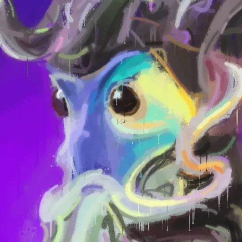
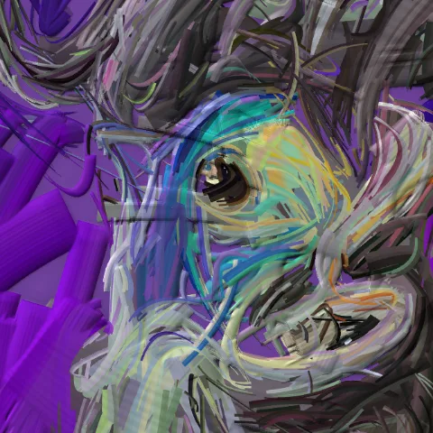
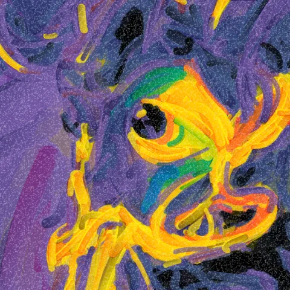
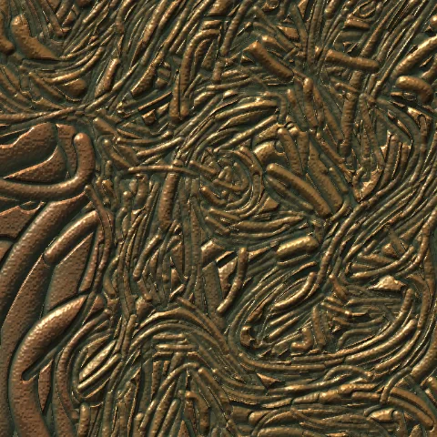

# Code Painter by JAS.BLACK

Version 4.26.3

Drop in any picture and watch it painted in code, stroke by stroke, with the program writing itself underneath.
Add a song and the painting follows its hits and sections; add stroke sounds and every stroke plays a note.
Record it as an MP4 (in real time, or rendered frame by frame), save the code, an SVG, 4K / 8K PNGs, stills and covers.
*window* (top of the out panel) opens the painting in a window of its own: drag it to a projector or a second screen
and double-click it for full screen.

Everything runs in the browser: pictures, songs and videos never leave the computer. No account, no server.
Best in Chrome, Edge or Brave on a desktop or laptop (Safari works too).

**[Open it: paint.jas.black](https://paint.jas.black)** · **[The guide: every feature, how to use it](docs/GUIDE.md)**

| | | |
|---|---|---|
|  |  |  |
|  |  |  |
|  |  |  |

## Quick start

1. Open the site and press **▶ try a demo**, or drop a picture or video anywhere on the page.
2. Pick a **look** (pencil, graffiti, watercolour, ink, chrome, hylics) and a **path** (free, one line, spiral out, top → bottom).
3. Add a song (or pick one of the 10 **demo ♪** songs); it paints to it: a big bold stroke on every beat, broad brushes when it's loud, fine ones when it's quiet, and on the 3D styles the surface flares on the beat.
4. **Record** (rendered smooth at 720p – 4K), **save the picture**, or **save as code**: a small web page that paints it again by itself.
5. Every file you save carries its settings: **drop it back on the page to get them back** (like ComfyUI's workflows).

48 styles in five groups: paint, draw, graphic, craft and 3d (lit in 3D: metals, ceramic, glass, lens, crystal…). The full tour is in the [guide](docs/GUIDE.md).

## Use it

- **Online**: open the studio's link. It opens painting a JAS.BLACK picture; pick a demo, type a word or drop your
  own picture / video / song to take over.
- **On a phone**: the same link. A small screen gets its own layout: the painting (4:5, or 9:16 for reels) with
  its code over it and the essentials under it (a photo / video, the camera, the examples, the looks, the path, style,
  shapes, speed, restart, record, save). The full studio, with every control, is for a computer.
- **From this folder**: double-click `index.html`. Everything works except the 3D input, which needs the online
  version.
- **With Resolume** (Syphon / Spout in and out): a website can't reach other apps, so that is in the **local
  version**, a free download for Mac and Windows: *resolume ↓* in the studio's out panel, or
  `download/code-painter-local.zip`.

## What's in here

- `index.html`: the studio, the whole app in one page (its code, the painter's and the recorder's)
- `viewer3d.js` + `vendor/three/`: the 3D input (three.js, MIT licence, see its LICENSE)
- `CNAME`: the site's address for GitHub Pages (paint.jas.black): keep it with the other files
- `og-image.jpg`: the picture a shared link shows (the page's link preview points to it at https://paint.jas.black/)
- `download/code-painter-local.zip`: the local version (the studio run from your own computer, with the Resolume bridge)
- `studio/index.html`: forwards old links (…/studio/) to the studio
- `docs/`: the guide and the example pictures

## Credits

The wet, pencil and charcoal styles use ideas from p5.brush by Alejandro Campos Uribe (MIT licence, https://github.com/acamposuribe/p5.brush: stamped brush lines with a pressure profile) and Tyler Hobbs' watercolour method (a fractal-edged outline stacked in transparent layers), written again for this painter.
The *hylics* style is inspired by the claymation graphics of Mason Lindroth's game Hylics.
The relief materials (clay, ceramic, stone, foam, beads, puffy, terrazzo, metal, chrome, pewter, copper, gold, bronze) are inspired by the relief brushes of Vooolume by krftoools; they are written from scratch for this painter (a height map lit in WebGL 2).
The oil, acrylic and palette-knife paints are a bristle brush laid into the same height map: each bristle carries its own colour and ridge and runs dry towards the end of the stroke. Oil drags the wet paint already there along with it and a knife scrapes over the high spots, after the paint simulation of David Li's *paint* (MIT licence, https://github.com/dli/paint); p5.brush and MyPaint (libmypaint, ISC) showed how a stamped line is laid down progressively.

© 2026 JAS.BLACK. All rights reserved.
